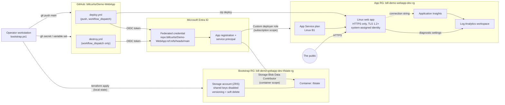

# Cloud Gone Wild

> Congratulations. You deployed another website nobody asked for.

A deliberately silly, fully automated, public website on Azure App Service. Terraform provisions the infrastructure. GitHub Actions deploys it with OpenID Connect (OIDC) workload identity federation. No client secrets exist anywhere.

**Live site:** _set after the first successful deployment (see [Final website address](#final-website-address))._

> [!WARNING]
> **Basic B1 is a billable App Service plan.** It accrues charges every hour it exists, even when nobody visits the site. Run the destroy workflow when you're finished.

> [!WARNING]
> **Destroying the application does not remove the bootstrap resources.** The Terraform state storage account, the Microsoft Entra application, and GitHub settings remain until you remove them manually.

## Contents

- [Architecture](#architecture)
- [How the two-stage bootstrap works](#how-the-two-stage-bootstrap-works)
- [Repository structure](#repository-structure)
- [Prerequisites](#prerequisites)
- [Required permissions](#required-permissions)
- [Run the bootstrap](#run-the-bootstrap)
- [How GitHub Actions authenticates](#how-github-actions-authenticates)
- [Remote Terraform backend](#remote-terraform-backend)
- [Deploy changes](#deploy-changes)
- [Destroy the application](#destroy-the-application)
- [Remove the bootstrap resources](#remove-the-bootstrap-resources)
- [Costs](#costs)
- [Security notes](#security-notes)
- [Troubleshooting](#troubleshooting)
- [Recover the original repository](#recover-the-original-repository)
- [Final website address](#final-website-address)

## Architecture



The website is plain HTML, CSS, and JavaScript in `site/`. No frameworks, npm, build step, external scripts, or external images. All visuals are CSS gradients, inline SVG, and a little JavaScript.

The web app uses the Linux PHP runtime only because its built-in nginx front end serves static files from `wwwroot` reliably. No PHP code is deployed.

## How the two-stage bootstrap works

Terraform needs somewhere to store state, and GitHub Actions needs an identity to sign in to Azure. Neither exists on day one, so setup happens in two stages.

1. **Stage 1, bootstrap (`infra/bootstrap`).** You run this once from your workstation. It creates the state storage account, the Entra application that GitHub Actions signs in as, the federated credential that trusts this repository's `main` branch, and the role assignments. Its own state is stored locally because the remote backend doesn't exist yet.
2. **Stage 2, application (`infra/app`).** GitHub Actions runs this on every push to `main`. It stores state in the storage account from stage 1 and creates the website resources.

### Bootstrap state

The bootstrap state file is `infra/bootstrap/terraform.tfstate` on the machine that ran `bootstrap.ps1`. It's git-ignored and contains resource IDs but no secrets (no client secrets or storage keys are ever created).

Protect it:

- Keep the file. Without it, a rerun would try to create a second storage account and Entra application.
- Back it up somewhere private, for example a password manager or a private, access-controlled storage location.
- To move it into the remote backend later, add a `backend "azurerm"` block with a different `key` (for example `bootstrap.tfstate`) to `infra/bootstrap/versions.tf` and run `terraform init -migrate-state`.

If the file is lost, re-import the resources with `terraform import` rather than re-creating them.

## Repository structure

```text
.github/workflows/
  deploy.yml            Terraform plan/apply + zip deploy + endpoint test
  destroy.yml           Manual destroy of infra/app only (requires DESTROY-DEV)
infra/
  bootstrap/            Stage 1: state storage, Entra app, OIDC credential, RBAC
  app/                  Stage 2: resource group, plan, web app, monitoring
site/
  index.html            The website
  styles.css
  script.js
scripts/
  Test-Deployment.ps1   Endpoint test used locally and in GitHub Actions
bootstrap.ps1           One-command setup from a Windows workstation
```

## Prerequisites

| Tool | Minimum | Install |
| --- | --- | --- |
| Git | any recent | `winget install --id Git.Git -e` |
| Terraform | 1.9.0 | `winget install --id Hashicorp.Terraform -e` |
| Azure CLI | 2.60 | `winget install --id Microsoft.AzureCLI -e` |
| GitHub CLI | 2.40 | `winget install --id GitHub.cli -e` |
| PowerShell | 5.1 or 7.x | Included with Windows |

## Required permissions

| Where | Permission | Why |
| --- | --- | --- |
| Azure subscription | **Owner**, or Contributor plus User Access Administrator | Create the state resources, a custom role, and role assignments |
| Microsoft Entra ID | Permission to register applications (default for members unless restricted), or Application Developer / Application Administrator | Create the GitHub Actions app registration and federated credential |
| GitHub repository | **Admin** | Set Actions secrets and variables, and change the default branch |

## Run the bootstrap

From the repository root in PowerShell:

```powershell
Set-Location C:\path\to\Demo-WebApp
.\bootstrap.ps1
```

If you're already signed in to both CLIs with the right accounts:

```powershell
.\bootstrap.ps1 -ReuseExistingLogin
```

### Interactive sign-in

- `az login` opens a browser. Sign in with an account that can access subscription `f1a77dc4-b955-4493-bb61-64b356fd32ae`. The tenant ID is read from that sign-in; it's never hardcoded.
- `gh auth login` opens a browser for a device code. Sign in with a GitHub account that has admin access to `billcurtis/Demo-WebApp`.

The script never prints tokens.

### What the bootstrap script does

1. Checks for Git, Terraform, Azure CLI, and GitHub CLI.
2. Confirms it's running in the right repository and that `origin` points to `billcurtis/Demo-WebApp`.
3. Signs in to Azure, selects and verifies the subscription, and checks your role.
4. Signs in to GitHub and verifies admin access.
5. Detects the default branch (falls back to `main` for an empty repository).
6. If no `backup-before-cloud-demo-*` branch exists on GitHub, snapshots the current branch plus uncommitted files into a new timestamped backup branch and pushes it. Your working tree isn't touched.
7. Registers the required Azure resource providers.
8. Applies `infra/bootstrap`, which creates:
   - Resource group `bill-demo-webapp-dev-tfstate-rg`
   - Storage account `billdemowebapptf<suffix>` with ZRS, TLS 1.2, HTTPS only, shared keys disabled, public blob access disabled, versioning, and 30-day blob and container soft delete
   - Private container `tfstate` and a `CanNotDelete` lock on the account
   - Entra application `bill-demo-webapp-dev-github-actions` and its service principal
   - Federated credential with subject `repo:billcurtis/Demo-WebApp:ref:refs/heads/main`
   - Custom role `bill-demo-webapp-dev-github-deployer` and the role assignments described in [Security notes](#security-notes)
9. Sets the GitHub Actions secrets and variables:

   | Name | Type |
   | --- | --- |
   | `AZURE_CLIENT_ID` | Secret |
   | `AZURE_TENANT_ID` | Secret |
   | `AZURE_SUBSCRIPTION_ID` | Secret |
   | `TF_STATE_RESOURCE_GROUP` | Variable |
   | `TF_STATE_STORAGE_ACCOUNT` | Variable |
   | `TF_STATE_CONTAINER` | Variable |
   | `TF_STATE_KEY` | Variable |

   The IDs aren't credentials, but storing them as secrets keeps them masked in this public repository's workflow logs.
10. Initializes and validates `infra/app` against the remote backend.
11. Commits and pushes to the default branch (never force-pushes), then sets it as the GitHub default branch if needed.
12. Watches the deployment workflow, reads the site address from Terraform state, and runs `scripts/Test-Deployment.ps1`.

Rerunning the script is safe. Terraform makes no changes if nothing drifted, the backup branch isn't recreated, and an unchanged commit isn't pushed again (the script dispatches the workflow instead if the last run failed).

## How GitHub Actions authenticates

1. The workflow has `permissions: id-token: write`, so GitHub can mint a short-lived OIDC token for the run.
2. The token's subject for a push or manual run on `main` is `repo:billcurtis/Demo-WebApp:ref:refs/heads/main`.
3. `azure/login` and the Terraform AzureRM provider (`ARM_USE_OIDC=true`) exchange that token with Microsoft Entra ID. Entra accepts it only because the federated credential trusts exactly that issuer, audience, and subject.
4. Entra returns an access token for the service principal. No client secret is created or stored.

Runs from any other branch, fork, or pull request get a different subject and are rejected by Entra ID.

## Remote Terraform backend

`infra/app/backend.tf` declares an `azurerm` backend with `use_azuread_auth = true`. The storage account, container, and key are passed at `terraform init` time from the `TF_STATE_*` repository variables:

```bash
terraform init \
  -backend-config="resource_group_name=$TF_STATE_RESOURCE_GROUP" \
  -backend-config="storage_account_name=$TF_STATE_STORAGE_ACCOUNT" \
  -backend-config="container_name=$TF_STATE_CONTAINER" \
  -backend-config="key=$TF_STATE_KEY"
```

Access uses Entra ID and the `Storage Blob Data Contributor` role on the `tfstate` container. Shared-key access is disabled on the account, so no storage key exists to leak. Terraform uses blob leases to lock state, and both workflows share one concurrency group so runs never overlap.

To run `infra/app` locally, sign in with `az login`, set `$env:ARM_SUBSCRIPTION_ID`, and run the same `init` command. The account that ran the bootstrap already has data access to the container.

## Deploy changes

Edit anything under `site/` or `infra/app/`, then commit and push to `main`:

```powershell
git add -A
git commit -m "Add more clouds"
git push
```

The **Deploy Cloud Gone Wild** workflow runs `terraform fmt -check`, `init`, `validate`, `plan`, and `apply`, then zips `site/`, deploys it, and tests the endpoint. You can also start it from the **Actions** tab with **Run workflow**.

## Destroy the application

1. Go to **Actions** > **Destroy Cloud Gone Wild (dev)** > **Run workflow**.
2. Leave the branch set to `main`.
3. Type `DESTROY-DEV` in **confirmation**, exactly.
4. Select **Run workflow**.

The workflow fails immediately, changing nothing, if the confirmation doesn't match or the branch isn't `main`. It has no push, pull request, or schedule trigger.

### What destroy keeps

- Terraform state resource group, storage account, and container
- The `infra/bootstrap` configuration and its local state
- The Entra application, service principal, and federated credential
- The custom role and role assignments
- GitHub secrets and variables

Run **Deploy Cloud Gone Wild** again to bring the site back.

## Remove the bootstrap resources

Do this only after running the destroy workflow, and only if you're done with the demo for good. Run from the repository root:

```powershell
az login
az account set --subscription f1a77dc4-b955-4493-bb61-64b356fd32ae

# 1. Remove the delete lock on the state account.
az lock delete --name bill-demo-webapp-dev-tfstate-lock `
  --resource-group bill-demo-webapp-dev-tfstate-rg `
  --resource <state-storage-account-name> `
  --resource-type Microsoft.Storage/storageAccounts

# 2. Allow Terraform to delete the storage account: in infra/bootstrap/main.tf,
#    change prevent_destroy = true to prevent_destroy = false (don't commit this).

# 3. Destroy the bootstrap stack.
terraform -chdir=infra/bootstrap destroy -var="subscription_id=f1a77dc4-b955-4493-bb61-64b356fd32ae"

# 4. Remove GitHub configuration.
foreach ($s in 'AZURE_CLIENT_ID','AZURE_TENANT_ID','AZURE_SUBSCRIPTION_ID') { gh secret delete $s --repo billcurtis/Demo-WebApp }
foreach ($v in 'TF_STATE_RESOURCE_GROUP','TF_STATE_STORAGE_ACCOUNT','TF_STATE_CONTAINER','TF_STATE_KEY') { gh variable delete $v --repo billcurtis/Demo-WebApp }
```

If the local bootstrap state is lost, delete the resource group `bill-demo-webapp-dev-tfstate-rg` (after removing the lock), the Entra application `bill-demo-webapp-dev-github-actions`, the custom role `bill-demo-webapp-dev-github-deployer`, and its role assignment in the portal or with `az`.

Deleted Entra applications stay in the recycle bin for 30 days.

## Costs

No exact prices are listed here because they vary by region, agreement, and date. Check the [Azure pricing calculator](https://azure.microsoft.com/pricing/calculator/).

| Resource | Billing behavior |
| --- | --- |
| App Service plan, Basic B1 (Linux) | **Largest cost.** Fixed hourly rate while the plan exists, regardless of traffic. |
| Log Analytics workspace | Per GB ingested and retained beyond the free allowance. A demo site generates very little. |
| Application Insights | Billed through the Log Analytics workspace. Minimal for a demo. |
| Storage account (state) | A few small blobs plus versions. Typically negligible. |
| Entra application, role assignments, GitHub Actions on a public repo | No direct charge. |

Running the destroy workflow removes the B1 plan and monitoring resources. The state storage account remains and keeps costing a negligible amount.

## Security notes

- **No client secrets.** GitHub Actions uses OIDC federation. The federated credential trusts only `repo:billcurtis/Demo-WebApp:ref:refs/heads/main`.
- **No storage keys.** The state account has shared-key access disabled and `default_to_oauth_authentication` enabled. All access uses Entra ID.
- **Least privilege.**
  - The GitHub identity has a custom subscription-scope role limited to resource groups, `Microsoft.Web`, `Microsoft.OperationalInsights`, `Microsoft.Insights`, and `Microsoft.AlertsManagement`. It has **no** `Microsoft.Authorization` rights, so it can't grant itself or anyone else access.
  - It has `Storage Blob Data Contributor` only on the `tfstate` container, not the whole account.
  - Subscription scope is needed because the app resource group is created and destroyed by Terraform.
- **Workflow permissions** are `contents: read` and `id-token: write` only.
- **State protection.** Blob versioning, 30-day soft delete for blobs and containers, ZRS replication, a `CanNotDelete` lock, and `prevent_destroy` in Terraform.
- **Web app hardening.** HTTPS only, minimum TLS 1.2 for the site and the deployment (SCM) endpoint, FTP and FTPS disabled, basic-auth publishing disabled for FTP and Web Deploy (deployment uses Entra ID), and a system-assigned managed identity.
- **Website content** contains no subscription, tenant, resource, or configuration details.
- Bootstrap Terraform state is local and git-ignored. See [Bootstrap state](#bootstrap-state).
- The Terraform provider is set to `prevent_deletion_if_contains_resources = false` for the app resource group only because Application Insights creates smart-detection resources that Terraform doesn't manage. This affects only the dev application resource group.

## Troubleshooting

| Symptom | Likely cause and fix |
| --- | --- |
| `AADSTS700213` or `AADSTS70021: No matching federated identity record found` | The workflow ran from a branch other than `main`, or the repository was renamed. Run from `main`, or update `github_branch` / `github_repository` and rerun `bootstrap.ps1`. |
| `AuthorizationFailed` during `terraform plan` or `apply` right after bootstrap | New role assignments can take several minutes to propagate. Re-run the workflow. |
| `403 AuthorizationPermissionMismatch` during `terraform init` | The identity lacks `Storage Blob Data Contributor` on the container, or the assignment hasn't propagated. Wait and retry; confirm with `az role assignment list --scope <container-id>`. |
| `Missing configuration for ...` in the first workflow step | Secrets or variables aren't set. Rerun `bootstrap.ps1`. |
| `state blob is already locked` | A previous run was cancelled mid-apply. Confirm nothing is running, then `terraform force-unlock <lock-id>` locally. |
| `terraform fmt -check` fails | Run `terraform fmt -recursive infra` and commit. |
| `az webapp deploy` returns 401 | The deploying identity needs write access on the site; check the custom role assignment. Basic auth is disabled by design, so don't re-enable it. |
| Endpoint test shows the default App Service page | The zip didn't have `index.html` at its root, or the app is still restarting. Check the **Package site** step and re-run. |
| `az login` picks the wrong tenant | Run `az login --tenant <tenant-id>` and rerun the script with `-ReuseExistingLogin`. |
| Script stops at "Admin permission ... is required" | Use a GitHub account with admin on the repository. |

Logs from the web app go to the Log Analytics workspace (`AppServiceHTTPLogs`, `AppServiceConsoleLogs`, `AppServicePlatformLogs`, and more).

## Recover the original repository

Before replacing anything, the bootstrap created a branch named `backup-before-cloud-demo-YYYYMMDD-HHMMSS` that holds the previous content of the default branch, including uncommitted and untracked files. Find it:

```powershell
git fetch origin
git branch -r --list "origin/backup-before-cloud-demo-*"
```

To look at the old content without changing anything:

```powershell
git switch --detach origin/backup-before-cloud-demo-YYYYMMDD-HHMMSS
```

To restore the old content onto `main` as a new commit (no force push):

```powershell
git switch main
git restore --source origin/backup-before-cloud-demo-YYYYMMDD-HHMMSS --staged --worktree -- .
git clean -fd   # removes files that didn't exist in the backup; review with -n first
git commit -m "Restore content from backup branch"
git push
```

Don't delete or overwrite the backup branch.

## Final website address

_Populated after the first successful deployment._

The address is also printed at the end of `bootstrap.ps1`, shown in every deployment run summary, and available from `terraform -chdir=infra/app output -raw website_url`.

## License

[MIT](LICENSE)
